# Manual de usuario · Plenum

Plenum es una plataforma para estudiar con **LARIA**, un tutor con inteligencia artificial
que se adapta a ti: a tu nivel, a lo que te cuesta y a cómo prefieres que te expliquen.
Este manual explica cómo usarla paso a paso.

> Las capturas usan datos de ejemplo (la estudiante «ana» aprendiendo ecuaciones
> lineales). En tu cuenta verás tus propios chats, clases y progreso.

## Índice

1. [Entrar en Plenum](#1-entrar-en-plenum)
2. [El tutorial de bienvenida](#2-el-tutorial-de-bienvenida)
3. [La pantalla principal](#3-la-pantalla-principal)
4. [Hablar con LARIA en el chat](#4-hablar-con-laria-en-el-chat)
5. [Estudiar con tus apuntes](#5-estudiar-con-tus-apuntes)
6. [La nivelación](#6-la-nivelación)
7. [Las clases guiadas](#7-las-clases-guiadas)
8. [La prueba de paso](#8-la-prueba-de-paso)
9. [Mis clases](#9-mis-clases)
10. [Tu perfil: metas, voz y estilo](#10-tu-perfil-metas-voz-y-estilo)
11. [Quizzes](#11-quizzes)
12. [Voz y dictado](#12-voz-y-dictado)
13. [Tu cuenta](#13-tu-cuenta)
14. [En el móvil y en modo oscuro](#14-en-el-móvil-y-en-modo-oscuro)
15. [Preguntas frecuentes](#15-preguntas-frecuentes)

---

## 1. Entrar en Plenum

Abre **https://laria-frontend.vercel.app**. En la portada verás qué es Plenum y dos
botones: **Crear cuenta** si es tu primera vez y **Ya tengo cuenta** si ya te registraste.

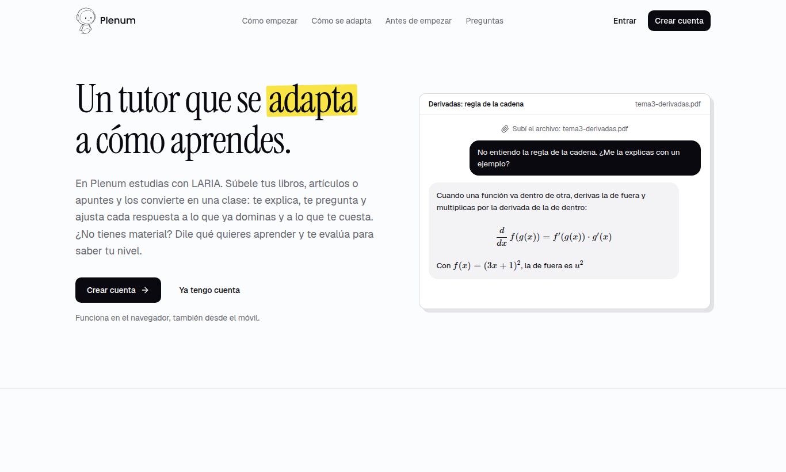

Para entrar o registrarte tienes tres opciones:

- **Google** o **Microsoft**: pulsa el botón y elige tu cuenta.
- **Correo electrónico**: escribe tu correo y pulsa **Continuar**. Te llegará un código
  para confirmar que es tuyo.

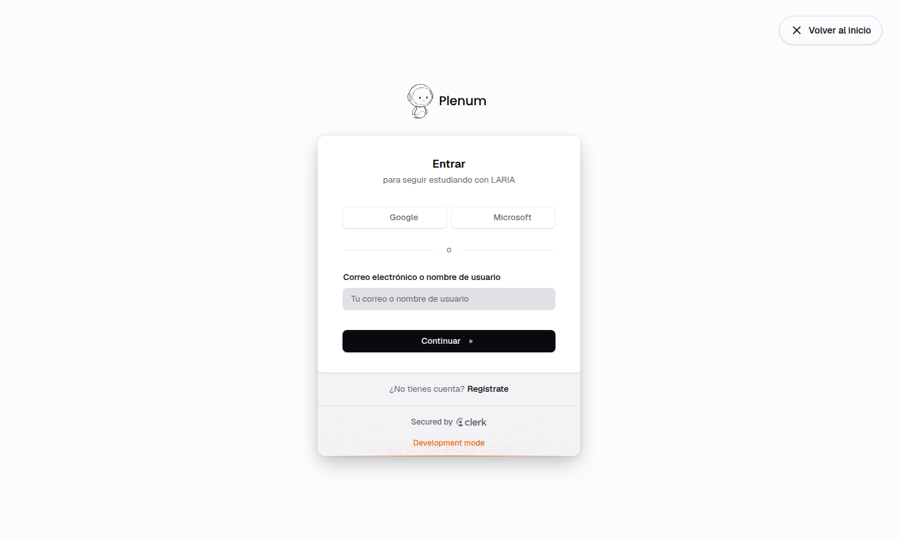

Al entrar llegas a un chat nuevo. Si alguna vez ves «Inicio de sesión no configurado»,
el problema es del servidor, no de tu cuenta: vuelve a intentarlo en un rato.

## 2. El tutorial de bienvenida

La primera vez que entras, LARIA se presenta y te enseña la aplicación en **6 pasos**:
el chat, la nivelación, las clases por tramos, tus apuntes y tu ritmo de estudio.

- **Siguiente** pasa al paso siguiente y **Saltar** cierra el tutorial.
- La tecla **Esc** también lo cierra.

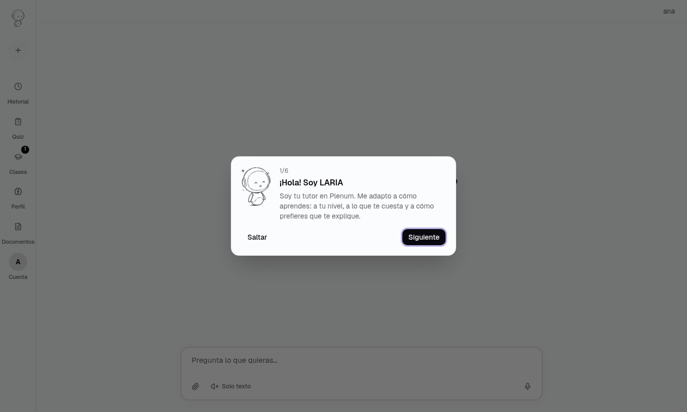

Para volver a verlo, abre el menú de **Cuenta** (abajo en la barra lateral) y elige **Ver
el tutorial de nuevo**.

## 3. La pantalla principal

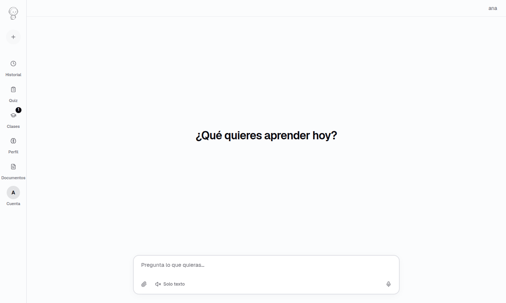

A la izquierda está la **barra lateral**:

| Botón | Qué hace |
|---|---|
| **+** | Empieza un chat nuevo |
| **Historial** | Tus chats recientes: ábrelos, cámbiales el nombre o bórralos |
| **Quiz** | Cuestionarios sobre el material de un chat |
| **Clases** | Tus clases guiadas. El número indica cuántas tienes en curso |
| **Perfil** | Tu progreso, tus metas, la voz de LARIA y tu estilo |
| **Documentos** | Los archivos que has subido y si ya están analizados |
| **Cuenta** | Tema claro u oscuro, gestionar la cuenta, el tutorial y cerrar sesión |

Abajo está la **caja de mensaje**. Desde ella puedes escribir, adjuntar archivos
(📎), activar la voz (**Solo texto** / **Leer en voz**) y dictar con el micrófono (🎤).

## 4. Hablar con LARIA en el chat

Escribe lo que quieras y pulsa **Enter**. La respuesta va apareciendo mientras LARIA
la escribe. Las fórmulas se ven como en un libro.

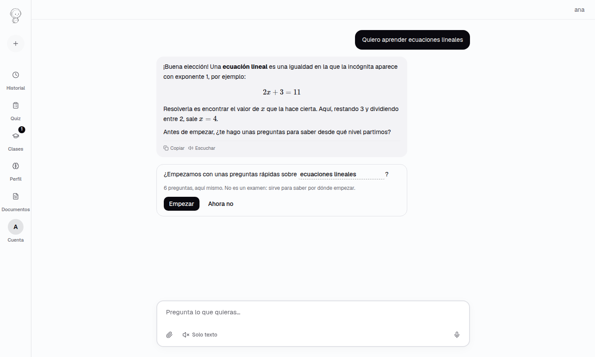

Debajo de cada respuesta tienes dos botones:

- **Copiar**: copia el texto de la respuesta.
- **Escuchar**: LARIA la lee en voz alta.

Según lo que pidas, LARIA te ofrece el siguiente paso en una tarjeta:

- Si dices **«quiero aprender…»** algo, te propone una **nivelación** para saber desde
  dónde partir (ver [sección 6](#6-la-nivelación)). Puedes corregir el tema antes de
  pulsar **Empezar**, o pulsar **Ahora no**.
- Si estás estudiando un documento, te ofrece un **cuestionario** sobre él.
- Te puede preguntar **cómo prefieres que te explique** (sencillo, paso a paso, con
  analogías…).

Un mensaje admite hasta **20000 caracteres**. Cuando escribes mucho aparece un contador.

**Temas que LARIA no trata.** Hay temas que no se trabajan en Plenum, como armas, drogas
o el odio. Si preguntas por uno, LARIA te lo explica con calma y te propone elegir otro.
Si escribes algo que muestra que lo estás pasando mal, LARIA responde con un mensaje de
apoyo.

## 5. Estudiar con tus apuntes

Pulsa 📎 en la caja de mensaje y elige un archivo:

- **Formatos:** PDF, Word, PowerPoint, Excel, texto o código.
- **Tamaño:** hasta **25 MB**.

LARIA lo analiza en segundo plano; en **Documentos** verás *Procesando…* y luego
*Analizado*. Desde ese momento explica a partir de tu material.

Las respuestas basadas en tu documento llevan la etiqueta **Tutoría**. El archivo
aparece encima de la caja de mensaje: púlsalo para verlo.

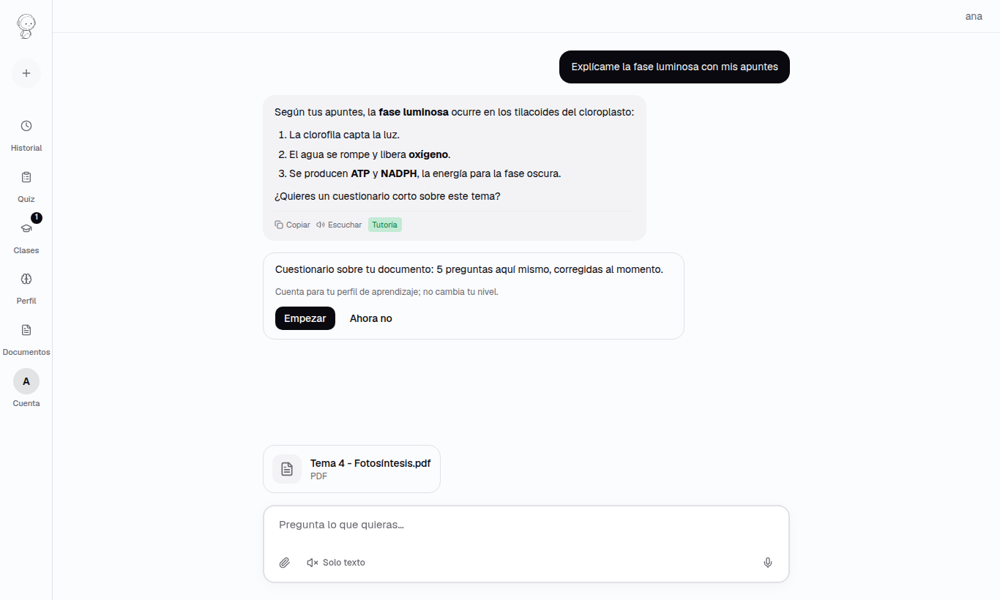

## 6. La nivelación

La nivelación sirve para que LARIA sepa **desde dónde empezar**. No es un examen: no hay
nota, y quedarte en lo básico también es un buen punto de partida.

1. Desde el chat («quiero aprender…») o desde **Clases → Nivelarme en un tema**, escribe
   el tema y pulsa **Empezar**.

   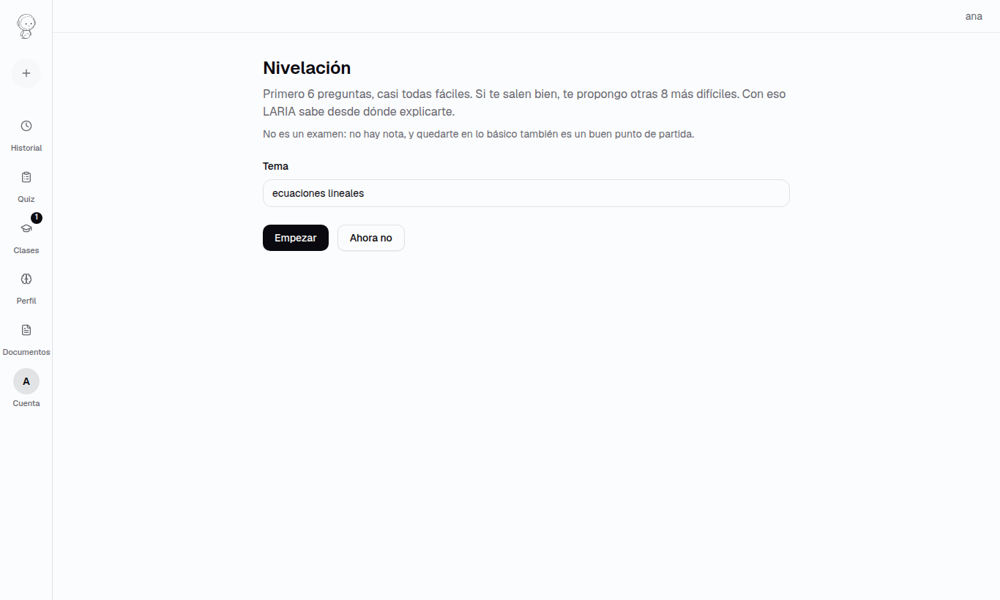

2. Responde a las preguntas. Elige una opción y pulsa **Siguiente**; con **Anterior**
   puedes volver atrás. Si te salen bien, LARIA te propone una segunda ronda más difícil.

   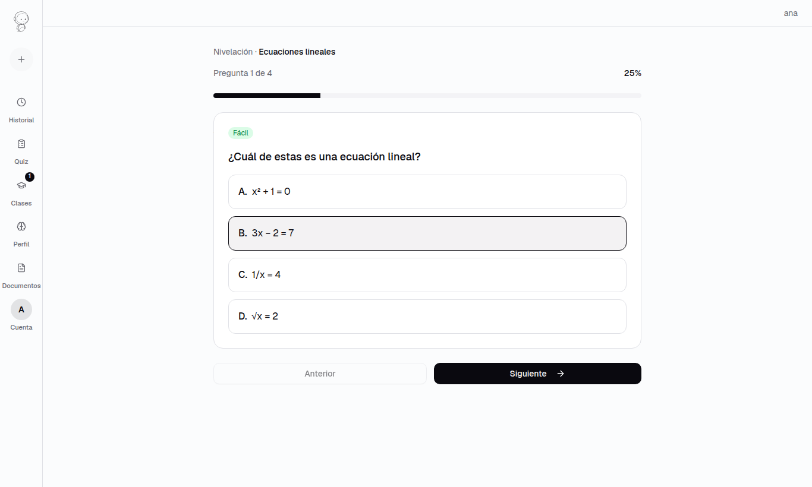

3. Al terminar verás **tu punto de partida** (básico, intermedio o avanzado). Mientras
   LARIA prepara la clase, elige:
   - **cuánto quieres que dure cada clase**: 10, 20, 30 o 45 minutos, o sin límite;
   - **cuánto quieres estudiar al día**: de 10 minutos a 1 hora, o sin objetivo;
   - **cómo prefieres que te explique**.

   En **Ver tus respuestas** puedes revisar qué acertaste.

   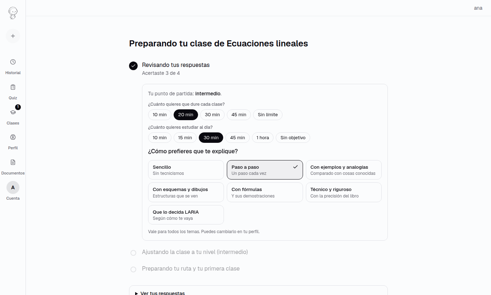

Cuando termina, LARIA abre tu **clase guiada**.

## 7. Las clases guiadas

Una clase es una **ruta de módulos** sobre un tema, ordenada por **tramos**: básico,
intermedio y avanzado. LARIA explica cada concepto en una **pizarra** y comprueba al
final que lo has entendido.

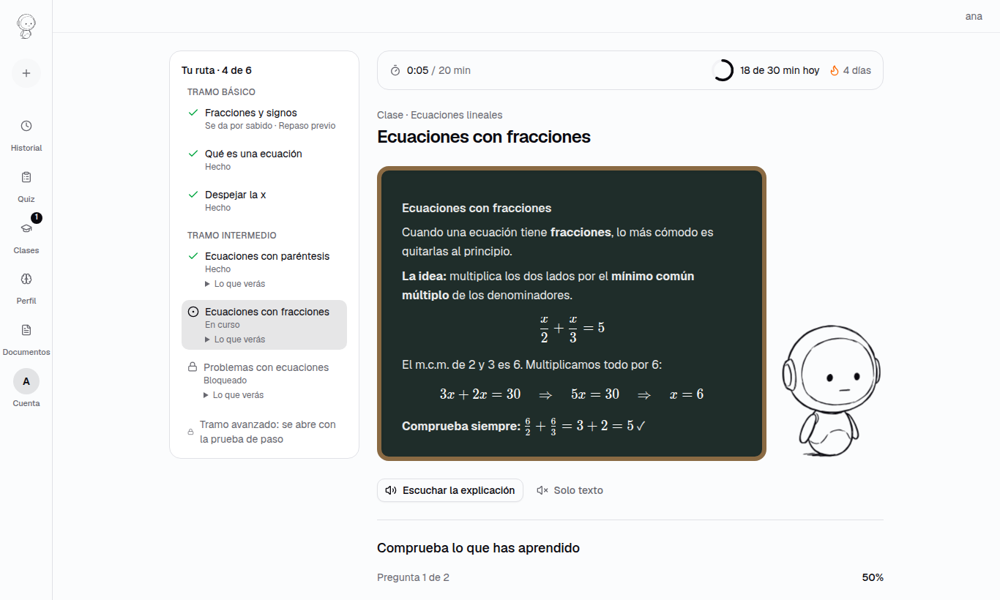

**A la izquierda, «Tu ruta».** Cada módulo tiene su estado:

| Estado | Qué significa |
|---|---|
| ✓ **Hecho** | Ya lo has superado |
| ✓ **Se da por sabido** | Por tu nivelación, no hace falta verlo |
| ⊙ **En curso** | Lo estás estudiando ahora |
| 🔒 **Bloqueado** | Se abre al terminar los anteriores |

Además:

- **Lo que verás** despliega las ideas clave de cada módulo.
- El último tramo se abre con la **prueba de paso** (ver [sección 8](#8-la-prueba-de-paso)).

**Arriba**, el cronómetro de la clase (por ejemplo, *0:05 / 20 min*), tu progreso de hoy
(*18 de 30 min*) y tu **racha** de días seguidos estudiando (🔥).

**En el centro, la pizarra.** LARIA explica el concepto con ejemplos y fórmulas. La
mascota se mueve mientras explica:

- **Señala** la pizarra en los datos importantes.
- **Habla** moviendo la boca al ritmo de la voz.
- **Reacciona** a tus resultados: celebra, te anima o tiene paciencia.

Pulsa **Escuchar la explicación** para que lea la pizarra frase a frase.

**Debajo, «Comprueba lo que has aprendido».** Son dos o tres preguntas cortas. En los
tramos intermedio y avanzado aparecen también las **fuentes** del tema.

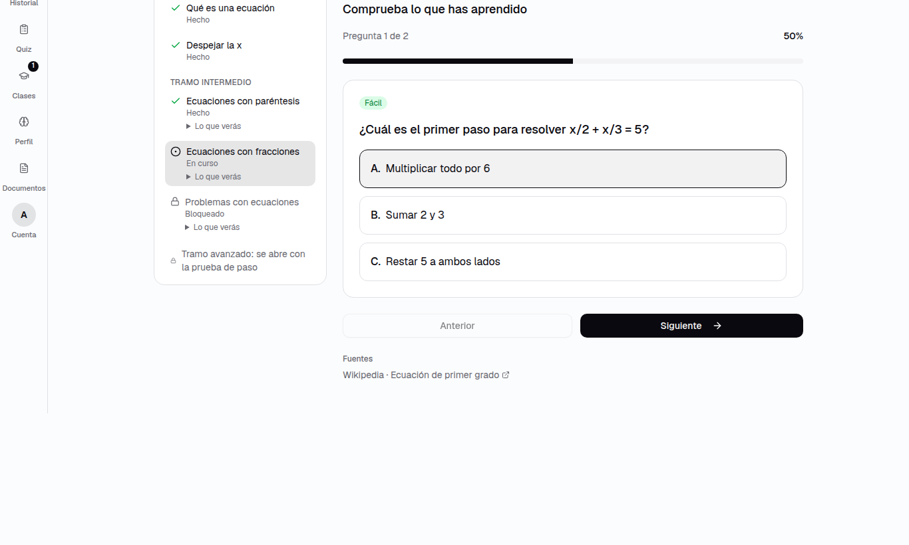

**El resultado.** Verás qué acertaste y LARIA decide el siguiente paso:

- **Entendido**: pasas al siguiente concepto.
- **A medias o no entendido**: LARIA te lo explica **de otra manera** (con una analogía,
  paso a paso…) o repasa antes algo previo que te falte.

Pulsa **Continuar** para seguir.

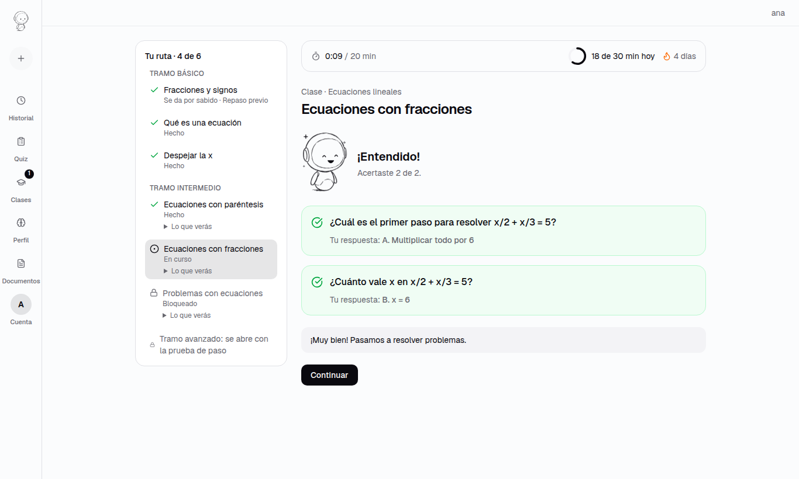

Si la clase tarda en prepararse, LARIA te avisa de que está trabajando en ello. Puedes
salir cuando quieras: la clase sigue donde la dejaste.

## 8. La prueba de paso

Cuando terminas todos los módulos de un tramo, la **prueba de paso** abre el siguiente
**en la misma ruta**. Puedes hacerla desde el aviso al final de la clase o desde **Mis
clases → Hacer la prueba de paso**.

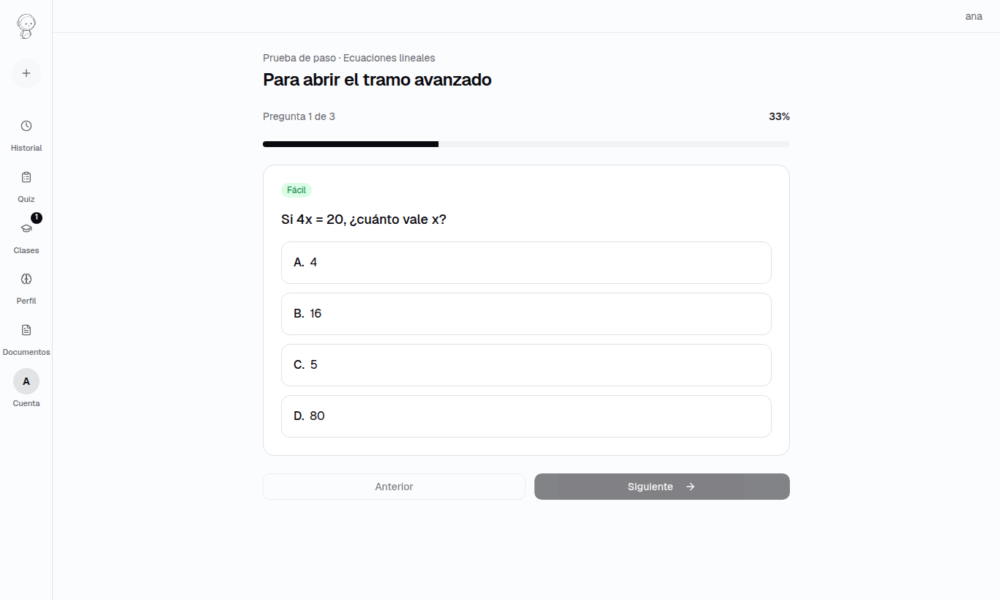

Las preguntas son sobre lo que acabas de estudiar.

- **Si la superas**: verás *¡Tramo … abierto!* y podrás pulsar **Empezar el tramo
  nuevo**.
- **Si no**: LARIA repasa contigo lo que más te ha costado, y puedes repetirla cuando
  quieras.

## 9. Mis clases

En **Clases** tienes todas tus clases, agrupadas por cómo van:

- **En curso**: con su progreso y el concepto en el que estás. Pulsa **Continuar**.
- **Pendientes de nivelación**: clases que esperan la nivelación o la prueba de paso.
- **Después de…**: al completar una ruta, LARIA te sugiere cómo seguir. Puede ser subir de
  nivel en el mismo tema o un tema relacionado.
- **Completadas**: si hace tiempo que no practicas una, LARIA te propone un repaso.

Arriba a la derecha está el anillo con tu **objetivo de hoy** y tu racha.

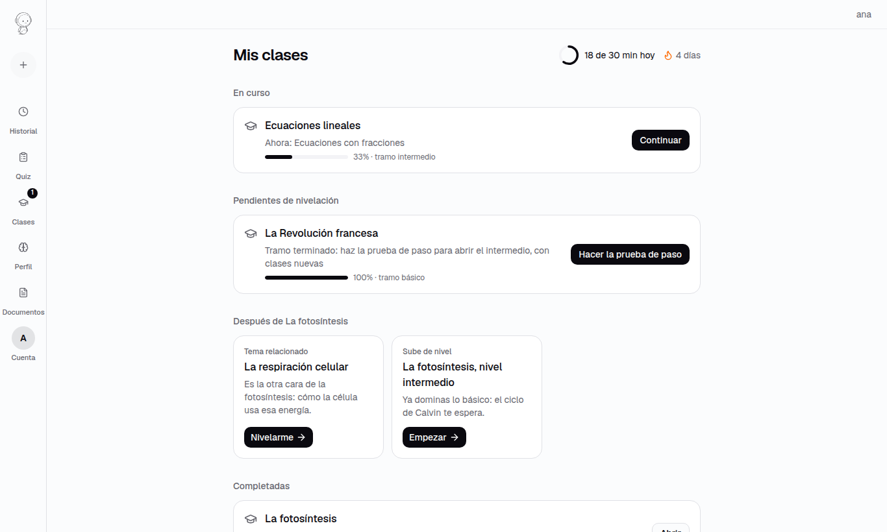

## 10. Tu perfil: metas, voz y estilo

En **Perfil** puedes cambiar:

- **Tus metas**: la duración de cada clase y tu objetivo diario.
- **La voz de LARIA**: hay 6 voces, 3 femeninas y 3 masculinas. Pulsa ▶ para
  escuchar una muestra y pulsa la tarjeta para elegirla.
- **Cómo prefieres que te explique**: vale para todos los temas. Aunque elijas uno, en un
  mensaje concreto puedes pedir otro («explícamelo paso a paso») y LARIA te hará caso.

También verás tu progreso:

- **El dominio de cada concepto.**
- **Tu nivel en cada tema.**
- **Tus fortalezas, lo que te cuesta y las recomendaciones de repaso.**

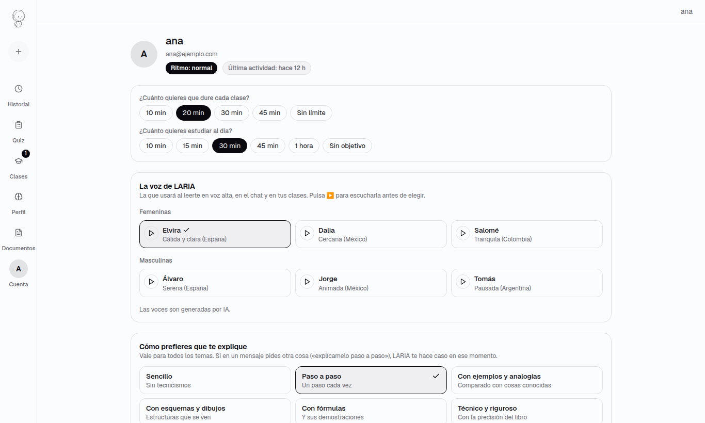

## 11. Quizzes

En **Quiz** puedes hacer un cuestionario sobre el material de un chat:

1. Elige el **chat** y el **número de preguntas**.
2. Pulsa **Generar Quiz**.
3. Responde a las preguntas. Al final verás tu puntuación y la respuesta correcta de cada
   pregunta.

Si no tienes material, escribe abajo qué quieres aprender y pulsa **Nivelarme**.

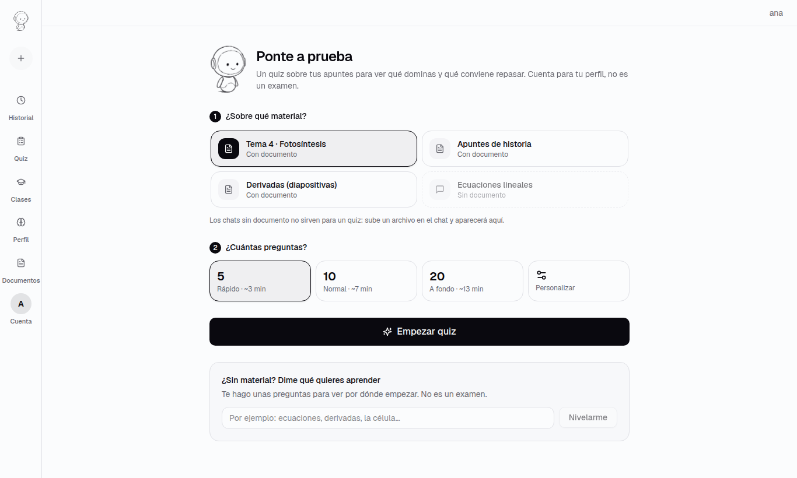

## 12. Voz y dictado

- **Leer en voz.** En la caja de mensaje, pulsa **Solo texto** para cambiar a **Leer en
  voz**. Desde ese momento LARIA lee sus respuestas mientras las escribe, frase a frase.
  Pulsa otra vez para volver a solo texto.
- **Dictado.** Pulsa el micrófono 🎤 y habla; tu voz se convierte en texto en la caja.
  Pulsa otra vez para parar.
  - Funciona en **Chrome, Edge y Safari**.
  - En el móvil se dicta **una frase por pulsación**.
  - La primera vez, el navegador te pedirá permiso para usar el micrófono.

  Si tu navegador no permite el dictado, el botón del micrófono no aparece.

## 13. Tu cuenta

En **Cuenta → Gestionar cuenta** puedes cambiar tu nombre, tu foto, tu correo y tus
métodos para entrar.

**Borrar tu cuenta.** Al final de la misma página está **Borrar mi cuenta**. Para
confirmar, escribe **BORRAR** y pulsa **Borrar definitivamente**.

- Si hace más de 10 minutos que entraste, se te pedirá que confirmes tu identidad otra
  vez (por ejemplo, con un código en tu correo). Es una protección para que nadie borre
  tu cuenta por ti.
- Se borra **todo**: tu cuenta, tus chats, tus documentos, tus clases y tu progreso.
  **No se puede deshacer.**

Para salir, pulsa **Cuenta → Cerrar sesión**.

## 14. En el móvil y en modo oscuro

Plenum funciona en el navegador del móvil, sin instalar nada:

- **La barra lateral** se abre con el botón ☰.
- **En la clase**, la ruta queda arriba y la pizarra debajo.

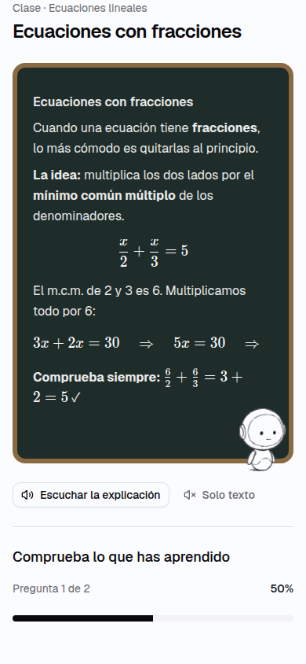

En **Cuenta → Tema** puedes elegir **Claro**, **Oscuro** o **Sistema**. Con **Sistema**,
Plenum usa el mismo tema que tu dispositivo.

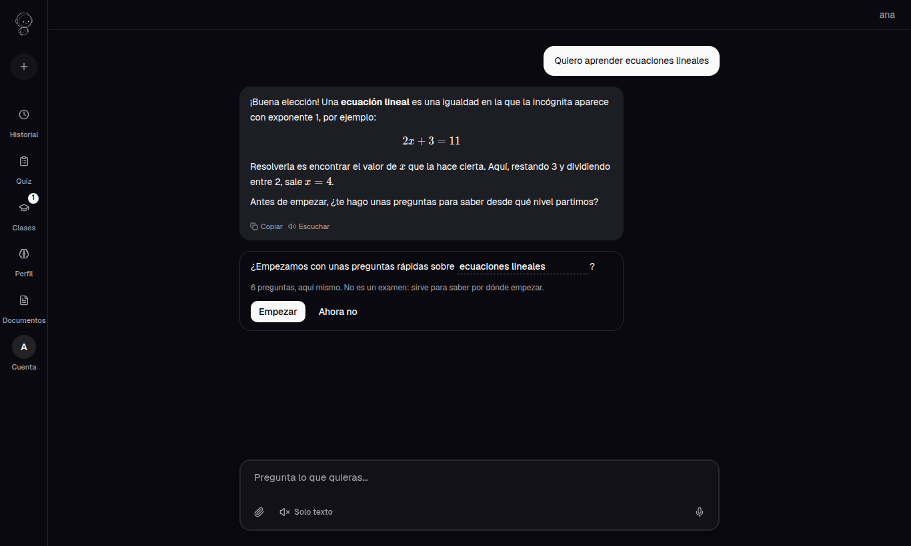

## 15. Preguntas frecuentes

**Las preguntas de nivelación me parecen fáciles.**
Es a propósito: la primera ronda son preguntas fáciles. Si te salen bien, LARIA te
propone una segunda ronda más difícil.

**Terminé una ruta, ¿y ahora?**
En **Mis clases** (y al final de la clase) LARIA te sugiere cómo seguir: subir de nivel
en el mismo tema o un tema relacionado.

**No me deja hacer la nivelación otra vez.**
Si tus respuestas de una ronda ya se guardaron, verás un aviso y podrás empezar una
ronda nueva.

**La voz no suena.**
Comprueba que la caja de mensaje está en **Leer en voz** y que el dispositivo no está en
silencio. En una respuesta concreta, también puedes pulsar **Escuchar**.

**El micrófono no aparece.**
Tu navegador no permite el dictado (por ejemplo, Firefox). Usa Chrome, Edge o Safari.

**«Espera un momento antes de volver a intentarlo».**
Has hecho muchos intentos seguidos. Espera unos segundos y vuelve a probar.
