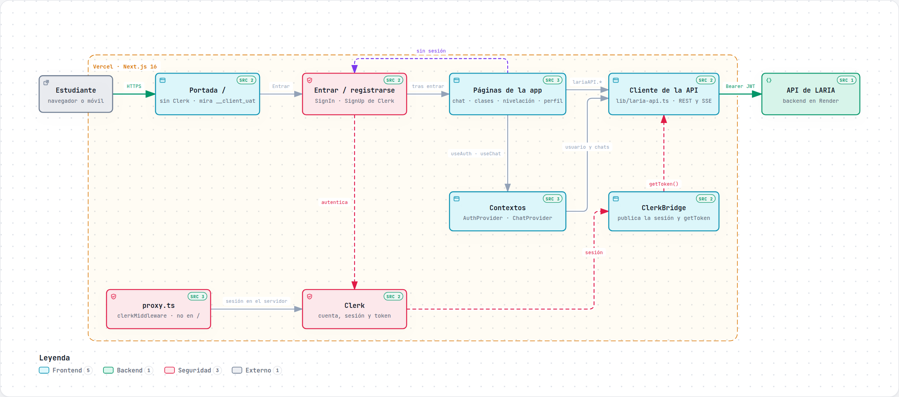
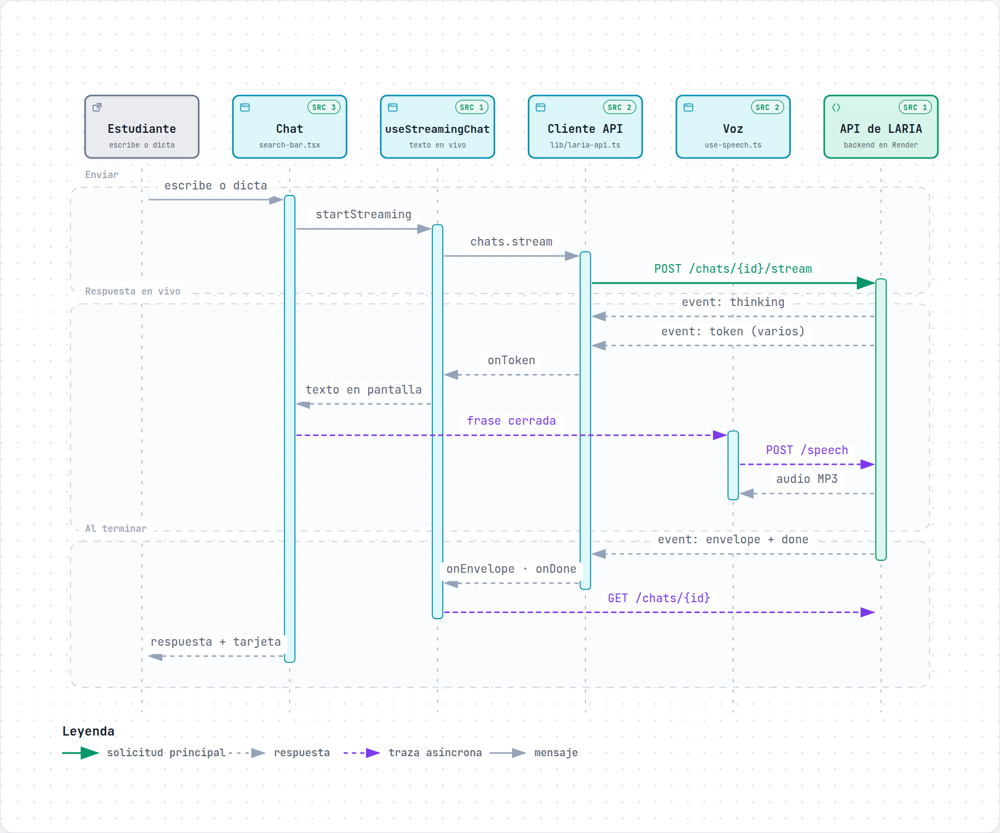
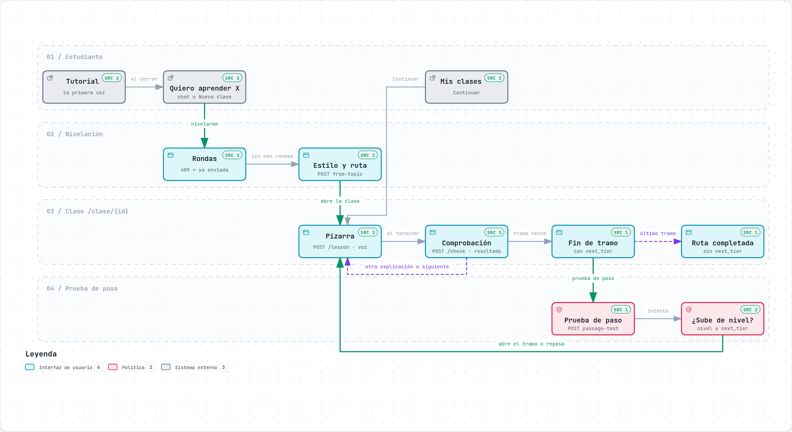

# Manual técnico · Plenum (frontend)

Este manual es para quien desarrolla, despliega o mantiene la web de Plenum (este
repositorio, **LARIA-UI**). El backend (FastAPI, en Render) está en el repositorio
**LARIA-IA**, que tiene su propia documentación de contratos en `backend/docs/`.

Para un resumen rápido, el [README](../../README.md); para cómo se usa la app, el
[manual de usuario](manual-de-usuario.md).

## Índice

1. [Visión general](#1-visión-general)
2. [Puesta en marcha](#2-puesta-en-marcha)
3. [Estructura del código](#3-estructura-del-código)
4. [Sesión y Clerk](#4-sesión-y-clerk)
5. [El cliente de la API](#5-el-cliente-de-la-api)
6. [Las pantallas y su flujo](#6-las-pantallas-y-su-flujo)
7. [Voz, dictado y mascota](#7-voz-dictado-y-mascota)
8. [Límites y seguridad](#8-límites-y-seguridad)
9. [Tests y calidad](#9-tests-y-calidad)
10. [Despliegue](#10-despliegue)
11. [Problemas conocidos y soluciones](#11-problemas-conocidos-y-soluciones)
12. [Cómo se hicieron las capturas y los diagramas](#12-cómo-se-hicieron-las-capturas-y-los-diagramas)

---

## 1. Visión general

| Pieza | Dónde | Qué hace |
|---|---|---|
| Web (este repo) | Vercel · https://laria-frontend.vercel.app | Interfaz: chat, clases, nivelación, perfil, cuenta |
| API | Render · https://laria-ia.onrender.com/api/v1 | Tutor (LLM), rutas de aprendizaje, quizzes, documentos, voz |
| Cuenta | Clerk (aplicación **Plenum**) | Registro, inicio de sesión, perfil y reverificación |

La web es una aplicación **de cliente**:

- Las páginas cargan sus datos en el navegador, llamando a la API con el token de
  sesión de Clerk.
- Quien exige el token es el backend. La web no protege rutas en el servidor.



**Tecnología:**

| Qué | Con qué |
|---|---|
| Framework | Next.js 16 (App Router, Turbopack), React 19, TypeScript |
| Estilos | Tailwind CSS v4, shadcn/Radix, `next-themes` (claro, oscuro, sistema) |
| Cuenta | `@clerk/nextjs` 7, con localización propia en español (`lib/clerk-localization.ts`) |
| Contenido | `react-markdown` + `remark-gfm`. Las fórmulas usan `remark-math` + `rehype-katex` y se cargan de forma diferida (`math-markdown.tsx`) |
| Notificaciones | `sonner` |
| Animación | CSS (mascota y pizarra). `motion` solo se usa en la portada |
| Tests | Vitest + Testing Library (jsdom) |

## 2. Puesta en marcha

Requisitos:

- **Node 20 o superior.** Vercel y la CI usan la 24.
- **pnpm 10 o superior.** pnpm 9 no entiende `pnpm-workspace.yaml`; si es el que tienes,
  usa `npx -y pnpm@10`.

```bash
pnpm install          # también instala los hooks de git (husky)
pnpm dev -p 4321      # http://localhost:4321
```

Usa el puerto **4321**: es el origen que el backend permite por CORS en desarrollo. El
backend también incluye `http://localhost:3000` en su lista por defecto, pero en Render
solo funciona si la variable `CORS_ORIGINS` del servicio lo incluye.

### Variables de entorno

Van en `.env.local`, que no se sube al repositorio.

| Variable | Valor | Notas |
|---|---|---|
| `NEXT_PUBLIC_LARIA_API_URL` | `/backend` en Vercel | Por defecto, `http://localhost:8000/api/v1`. También vale la URL completa de la API |
| `LARIA_API_ORIGIN` | `https://laria-ia.onrender.com` | **Solo servidor** (sin `NEXT_PUBLIC_`). Origen al que reenvía el proxy `/backend`; sin ella no hay proxy |
| `NEXT_PUBLIC_CLERK_PUBLISHABLE_KEY` | `pk_test_…` o `pk_live_…` | Pública: va en el JS del navegador |
| `CLERK_SECRET_KEY` | `sk_test_…` o `sk_live_…` | **Secreta.** Nunca en el código, en un commit ni en un chat |
| `NEXT_PUBLIC_CLERK_SIGN_IN_URL` | `/sign-in` | |
| `NEXT_PUBLIC_CLERK_SIGN_UP_URL` | `/sign-up` | |
| `NEXT_PUBLIC_CLERK_SIGN_IN_FALLBACK_REDIRECT_URL` | `/chat` | A dónde ir tras entrar |
| `NEXT_PUBLIC_CLERK_SIGN_UP_FALLBACK_REDIRECT_URL` | `/chat` | A dónde ir tras registrarse |

Las `NEXT_PUBLIC_…` se incrustan **al compilar**: si cambias una en Vercel, hay que
volver a desplegar (Redeploy).

## 3. Estructura del código

```
app/
  page.tsx                   Portada (sin Clerk)
  sign-in/, sign-up/         Pantallas de Clerk (auth-page.tsx)
  (chat)/chat/[id]           El chat con LARIA
  clase/[pathId]/            Clase guiada: pizarra, comprobación, tramos
    prueba-de-paso/          Prueba de paso al siguiente tramo
    class-board.tsx          Pizarra sincronizada con la voz
    module-sources.tsx       Fuentes del módulo
  clases/                    Mis clases (tarjetas, temario, borrar)
  nivelacion/                Nivelación en un tema
  quiz/                      Quizzes (quiz-parts.tsx: preguntas y resultados, compartidos)
  perfil/                    Progreso, metas, voz y estilo
  cuenta/[[...cuenta]]       <UserProfile> de Clerk + borrar la cuenta
  components/                Componentes compartidos (delete-class-dialog.tsx: confirmar el borrado)
  contexts/                  AuthProvider (usuario de Plenum) y ChatProvider (chats)
hooks/                       use-speech, use-dictation, use-study-time…
lib/
  laria-api.ts               Cliente de la API
  routes.ts                  Rutas de la app, en un solo sitio
  classes.ts                 Agrupar rutas, tramos, progreso y cómo va cada concepto
  clerk-config.ts            ¿Hay claves de Clerk?
  session-hint.ts            ¿Hay sesión? (cookie __client_uat, para la portada)
  onboarding.ts              «Ver el tutorial de nuevo»
proxy.ts                     Middleware de Clerk (el «middleware» de Next 16)
test/                        Utilidades de los tests (SSE, voz y dictado simulados)
docs/diagramas/              Diagramas (archify)
docs/manuales/               Estos manuales y sus capturas
```

**Convenciones:**

- Las rutas se construyen siempre con `lib/routes.ts` (`classHref`, `placementHref`…).
- Los textos de la interfaz van en español y tutean.
- Los comentarios explican decisiones, no lo obvio.

## 4. Sesión y Clerk

### Cómo fluye la sesión

1. **`app/layout.tsx` → `AppProviders`.** En `/` (la portada) no carga nada de sesión.
   En el resto de páginas carga `SessionProviders` con `next/dynamic`, así la portada no
   baja Clerk (~1 MB de JS).
2. **`SessionProviders`** monta `ClerkProvider` (en español y con el tema shadcn),
   `ClerkBridge`, `AuthProvider`, `ChatProvider` y el tutorial (`OnboardingTour`).
3. **`ClerkBridge`** publica en `lib/laria-api.ts` el estado de la sesión (`loading`,
   `signed-in` o `signed-out`) y la función `getToken()` de Clerk. El resto de la app no
   importa Clerk.
4. **`AuthProvider`** escucha esa sesión. Cuando hay sesión, pide `GET /users/me` y
   expone `user`, `isAuthenticated`, `isLoading` y `connectionError`.
5. **`RequireAuth`** envuelve cada página privada:
   - sin sesión, lleva a `/sign-in?redirect_url=…`;
   - si hay sesión pero el backend no responde, muestra el error con **Reintentar**.
6. **`proxy.ts`** pasa `clerkMiddleware()` a todas las rutas menos `/`.

**Sin claves de Clerk, la app no se cae:**

- `proxy.ts` deja pasar las peticiones.
- `NoAuthBridge` publica `signed-out`.
- Las pantallas de entrar explican que el inicio de sesión no está configurado.

La excepción es `/cuenta`, que sí necesita Clerk (ver la
[sección 11](#11-problemas-conocidos-y-soluciones)).

**La portada sin Clerk** sabe si hay sesión leyendo la cookie `__client_uat`
(`lib/session-hint.ts`). Con sesión, muestra «Ir a mis chats» en vez de «Crear cuenta».

### El token

- Cada petición llama a `getToken()`. Clerk lo cachea y lo renueva solo; los tokens duran
  60 s.
- Si el backend responde **401**, se reintenta **una vez** con
  `getToken({ skipCache: true })`. Si vuelve a dar 401, se cierra la sesión
  (`onUnauthorized` → `signOut`).
- El backend valida el JWT con el JWKS de la instancia de Clerk (emisor
  `https://glorious-bluejay-3695.clerk.accounts.dev` en desarrollo). Crea el usuario de
  Plenum la primera vez que ve un `sub` nuevo.

### Configuración del panel de Clerk

Aplicación **Plenum**, instancia **Development** (`app_3K46eY3uQeYFawU4Jzq9GGBm1rw`). Lo
que importa para esta web:

| Ajuste | Dónde | Valor | Por qué |
|---|---|---|---|
| Métodos de entrada | User & authentication | Correo con código, Google, Microsoft | Los que ofrece `/sign-in` |
| *Default claims* del token | Sessions → Customize session token | Incluyen `fva`, `v` y `fea` (token v2) | El backend lee `fva` para exigir una verificación reciente al borrar la cuenta |
| Ventana de reverificación | Sessions → Reverification window | **10 minutos** | Tiempo que vale un inicio de sesión para acciones sensibles |
| Vida de la sesión | Sessions → Maximum lifetime | 7 días | |

Revisado el 2026-10-12: el token ya incluye `fva` entre sus claims por defecto, así que
no hace falta ninguna plantilla de JWT.

**Para pasar a producción** (instancia *Production* de Clerk):

1. Crea la instancia con **Go to prod** y configura el dominio propio con sus DNS.
2. Pon las claves `pk_live_…` y `sk_live_…` en Vercel (Production).
3. Pon el emisor y el JWKS nuevos en el backend (Render).
4. Vuelve a configurar Google y Microsoft con credenciales OAuth propias: las de
   desarrollo son compartidas de Clerk.

### Borrar la cuenta

`app/cuenta/delete-account.tsx` llama a `DELETE /users/me` envuelto en
`useReverification` de Clerk:

- El cuerpo va vacío: al backend le basta una verificación de identidad en Clerk de hace
  10 minutos o menos, que lee del claim `fva` del token (ADR-041 del backend).
- Si el backend responde 403 con `reason: "reverification_required"`, Clerk abre su
  diálogo de verificación y se repite la llamada.
- Si el estudiante cancela el diálogo, no se muestra ningún error.
- El backend borra también el usuario en Clerk, así que la sesión no puede volver a
  crear la cuenta. Si Clerk falla, responde 503 sin haber borrado nada y se puede
  reintentar.
- Al terminar, se cierra la sesión y la portada muestra un aviso
  (`landing/account-deleted-notice.tsx`).

## 5. El cliente de la API

Todo pasa por `lib/laria-api.ts`. `request()` hace lo común:

- añade la URL base y el token;
- reintenta tras un 401;
- convierte los errores en `ApiError`, con `status`, `reason`, `safety` y un mensaje en
  español para mostrar.

`isUnsafeTopic(err)` reconoce un 422 con `reason: "unsafe_topic"`.

| Espacio | Métodos | Endpoints |
|---|---|---|
| `auth` | `me`, `completeOnboarding`, `deleteAccount` | `GET /users/me`, `POST /users/me/onboarding`, `DELETE /users/me` |
| `chats` | `list`, `get`, `create`, `update`, `delete`, `addMessage`, `stream`, `generateQuiz`, `generateTitle` | `/chats/…`. El turno va por `POST /chats/{id}/stream` (SSE) |
| `quizzes` | `practice`, `diagnostic`, `submitAttempt` | `/quizzes/practice`, `/quizzes/diagnostic`, `/quizzes/{id}/attempts` |
| `paths` | `fromTopic`, `list`, `get`, `delete`, `lesson`, `check`, `next`, `passageTest` | `/learning/paths/…`. `delete` trata un 404 como borrada y avisa con `onPathsChanged` |
| `study` | `goals`, `setGoals`, `ping`, `summary` | `/learning/me/study-goals`, `/learning/me/study-time` |
| `learning` | `history`, `profile`, `preferences`, `setPreferences` | `/learning/me`, `/learning/me/profile`, `/learning/me/preferences` |
| `speech` | `config`, `voices`, `setVoice`, `synthesize` | `/speech/config`, `/speech/voices`, `/speech/voice`, `POST /speech` |
| `documents` | `list`, `get`, `upload`, `content`, `analyze`, `ask`, `delete` | `/documents/…` |

El contrato de cada endpoint está en el repositorio del backend:
`backend/docs/api-contracts.md` y `backend/docs/endpoints.md`.

**Compatibilidad hacia atrás.** Si un endpoint nuevo responde **404** (el backend
desplegado aún no lo tiene), esa parte de la interfaz no se muestra; por ejemplo, las
metas, las voces o las sugerencias. Así el frontend puede desplegarse antes que el
backend.

### Un turno del chat (SSE)

El backend emite estos eventos:

- **`thinking`**: qué está haciendo. La interfaz lo muestra como indicador.
- **`token`**: un trozo de texto. Se va pintando y, con «Leer en voz», cada frase
  completa se manda a `/speech`.
- **`envelope`**: el resultado final. Lleva `emotion` y `payload`: `suggest_placement`,
  `topic_hint`, `offer_quiz`, `ask_learning_style`, `grounded`, `safety`…
- **`done`**: fin del turno.

`offerFor()` (en `search-bar.tsx`) decide la tarjeta que se ofrece tras la respuesta. Si
el envelope trae `safety`, no ofrece nada.



## 6. Las pantallas y su flujo

### El recorrido del estudiante



### Nivelación → clase

La nivelación está en dos sitios: como tarjeta en el chat (`chat-quiz.tsx`) y en
`/nivelacion` (`app/nivelacion/page.tsx`). Las dos siguen los mismos pasos:

1. `POST /quizzes/diagnostic {topic}` devuelve las preguntas de la ronda.
2. `POST /quizzes/{id}/attempts` devuelve `placement`, con `level`, `passed` y
   `has_next_round`.
3. **Cada ronda se responde una sola vez.** Si al reenviarla (por ejemplo, un reintento
   tras perder la red) el backend responde **409**, no se trata como error: se avisa de
   que ya estaba guardada y se sigue con otra ronda.
4. Si hay ronda siguiente, se ofrece **Seguir**. Si no, se pregunta el estilo de
   explicación y se crea la ruta (`POST /learning/paths/from-topic`, idempotente: si ya
   existe la del tema, devuelve la misma).
5. Se navega a `/clase/{id}`. Un backend sin rutas (404 o 405) abre la clase en un chat.

### La clase guiada

`app/clase/[pathId]/page.tsx` sigue una máquina de estados que lleva el backend en
`path.teaching.phase`. Las fases son `assessment`, `teaching`, `check`, `remediation`,
`advance` y `completed`.

- **`POST …/lesson`** devuelve `{ path, markdown, check }`: la explicación para la
  pizarra y la comprobación. Una comprobación pendiente se devuelve igual, así que
  recargar no pierde nada.
- **`POST …/check {quiz_id, answers}`** devuelve `{ outcome, next, path }`. El `outcome`
  puede ser:
  - `understood`: se pasa al siguiente concepto;
  - `partial` o `not_understood`: se explica otra vez con una variante (analogía, paso a
    paso…) o se vuelve a un prerrequisito (`return_to`).
- **Tramos.** Los módulos llevan `tier` (`basico`, `intermedio` o `avanzado`), y la ruta,
  `tiers` y `next_tier`.
  - `PathOutline` agrupa los módulos por tramo.
  - `lib/classes.ts` calcula `tierDone`, `currentTier` y `tierProgress`.
  - Al acabar un tramo, se lleva a la prueba de paso
    (`passageTestHref` → `POST …/passage-test`). La prueba es sobre los módulos del
    tramo terminado de **esa** ruta y, si se supera, abre el siguiente tramo en la misma
    ruta: nunca crea otra (ADR-042 del backend). Se responde con `quizzes.submitAttempt`.
  - **409 en la prueba de paso:** al pedirla, la ruta no tiene ningún tramo terminado con
    otro por delante; al enviarla, el intento ya estaba guardado. En los dos casos se
    explica sin reintentar.
  - **409 al abrir la clase** (`POST …/lesson`): el tema aún no tiene nivelación, y se
    ofrece hacerla.
- **Al completar la ruta**, `NextSuggestions` (`GET …/next`) propone subir de nivel o un
  tema relacionado.
- **Si tarda**, `useSlow` muestra un aviso pasados unos segundos.
- **El tiempo de estudio:**
  - `useStudyTime` envía `POST /learning/me/study-time` cada minuto, solo con la pestaña
    visible y el estudiante activo;
  - el cronómetro, el anillo del objetivo diario y la racha salen de
    `GET /learning/me/study-time?tz=…`.

### Mis clases

`app/clases/page.tsx` agrupa las rutas con tema (`classGroups`) en **En curso**,
**Pendientes** (nivelación o prueba de paso) y **Completadas**, de la más reciente a la más
antigua. La primera en curso va destacada.

- Cada tarjeta lleva:
  - qué toca: «Vas por», «Repaso pendiente» (`teaching.variant == "review"`) o
    «Prueba de paso disponible»;
  - el nivel en tres pasos según `tiers`;
  - el progreso del tramo en curso (`tierProgress`);
  - cuándo se estudió (`lastStudied`);
  - el temario desplegable.
- El dominio de cada concepto se muestra en palabras (`moduleLabel`: «Dominado», «En
  camino»…) y con una barrita de 3 pasos (`masterySteps`). Nunca se muestra como nota.
- **Borrar una clase** (`DeleteClassDialog`, desde la tarjeta o desde la clase):
  - Es un `alertdialog` modal: el foco empieza en «Cancelar», Tab no sale y Escape
    cierra.
  - `DELETE /learning/paths/{id}` borra la clase y su progreso en el temario. El backend
    conserva el dominio de los conceptos y el nivel del tema, así que recrearla no repite
    la nivelación.
  - Después, la tarjeta sale de la lista, el contador de la barra lateral se actualiza
    (`onPathsChanged`) y, desde la clase, se vuelve a `/clases`.

### Quizzes

`app/quiz/page.tsx` hace un quiz sobre el documento de un chat
(`POST /chats/{id}/quiz?num_questions=N`, de 1 a 20).

- **Ajustes:** el material se elige en tarjetas (los chats sin documento salen
  desactivados) y la cantidad con 5, 10 o 20 preguntas, o un número personalizado.
- **Preguntas** (`QuestionStep`, en `quiz-parts.tsx`): una barra con un tramo por
  pregunta y atajos de teclado (1–9 o la letra eligen; Enter avanza). Los atajos no se
  activan mientras se escribe en un campo.
- **Resultados:** porcentaje en un anillo, un mensaje según la nota, el filtro «Para
  repasar» y «Otro quiz igual».
- `QuestionStep` y `ResultsList` son compartidos con la nivelación, la comprobación de la
  clase y la prueba de paso.

### Tutorial de bienvenida

`OnboardingTour` se muestra si `user.onboarding_completed === false`:

- Recorre los anclajes `data-tour` de la interfaz en 6 pasos.
- Al terminar o saltarlo, llama a `POST /users/me/onboarding`.
- **Ver el tutorial de nuevo** (`lib/onboarding.ts`) lo vuelve a abrir sin tocar el
  backend.

## 7. Voz, dictado y mascota

- **`hooks/use-speech.ts`** lleva la cola de lectura:
  - frase a frase, con `speaking {key, index}` y `pendingKey`;
  - `getLevel()` lee el analizador de Web Audio para mover la boca de la mascota
    (`--mouth`). Solo conecta el analizador si el `AudioContext` está activo.
- **`hooks/use-dictation.ts`** usa la Web Speech API:
  - `transcriptFrom()` quita las repeticiones de los resultados finales acumulados que
    manda Android;
  - en el móvil, `continuous` es falso (una frase por pulsación);
  - el dictado sustituye lo dictado en la sesión de micrófono, no lo añade otra vez;
  - tras un error `network`, `service-not-allowed` o `language-not-supported`, se oculta
    el micrófono.
- **`laria-mascot.tsx`** dibuja la mascota con los trazos del logo
  (`laria-mascot-paths.ts`). La animación es CSS (`app/globals.css`) y respeta
  `prefers-reduced-motion`.
  - Estados: `idle`, `thinking` y `speaking`.
  - Emociones: `calm`, `encouraging`, `patient`, `celebratory` y `surprised`.
  - `pointing` hace que señale la pizarra.
- **`class-board.tsx`** muestra la frase que se está leyendo. Cuando una frase es
  importante (`isImportant()`), la mascota señala la pizarra.

## 8. Límites y seguridad

| Límite | Dónde | Qué pasa |
|---|---|---|
| 20000 caracteres por mensaje | `search-bar.tsx` (`MAX_MESSAGE_CHARS`) | `maxLength` en la caja, con contador a partir de 500. El dictado también se corta ahí. El backend aplica el mismo tope (ADR-046) |
| 25 MB por archivo | Backend | Error en español al subir |
| **409** al enviar respuestas ya guardadas | Nivelación y prueba de paso | Cada ronda se responde una sola vez. Aviso neutro y opción de una ronda nueva o de volver a la clase |
| **429** demasiadas peticiones | Cliente de la API | «Espera un momento antes de volver a intentarlo.» |
| **422** `unsafe_topic` | Nivelación, clase y prueba de paso | Explicación sin tratarlo como error y **Elegir otro tema** |
| `safety: "support"` | Chat | Mensaje de apoyo con estilo sobrio y sin tarjetas de oferta |

**Buenas prácticas:**

- Las claves secretas (`CLERK_SECRET_KEY`) solo van en Vercel y Render. Si una se
  expone, hay que rotarla en Clerk (API keys).
- El token nunca se guarda en `localStorage`. Al cargar la app se borra el que dejaron
  las sesiones de antes de Clerk.
- Nunca se pone información personal en la URL.

### El proxy `/backend`

En producción el navegador no llama a Render: llama a `/backend/…` en el dominio de la
web, y Vercel lo reenvía (rewrites de `next.config.mjs`, definidos en
`lib/backend-proxy.mjs`).

| Ruta en la web | Destino |
|---|---|
| `/backend/health` | `LARIA_API_ORIGIN/health` (el ping que despierta Render) |
| `/backend/<ruta>` | `LARIA_API_ORIGIN/api/v1/<ruta>`, con la misma consulta y la barra final |

- **Qué gana:** el navegador no ve la URL de Render, no hay peticiones previas de CORS
  y, mientras Render despierta, el 502/504 llega como tal en vez de «Failed to fetch».
- **Qué no hace:** no protege la API. Render sigue siendo público; la protección es el
  token de Clerk, que el backend valida en cada petición, y su autorización por
  propietario.
- **El destino es fijo:** sale de `LARIA_API_ORIGIN`, que debe ser solo un origen
  `https` (la compilación falla si trae ruta, consulta o credenciales). Nada de la
  petición puede elegir otro host.
- `skipTrailingSlashRedirect`: sin él, Next quitaría la barra de `/chats/` con un 308 y
  FastAPI respondería con una redirección a su propia URL.
- `experimental.proxyClientMaxBodySize: "26mb"`: Next corta a 10 MB los cuerpos que
  pasan por el proxy; los documentos llegan a 25 MB.
- Las cookies de la web (las de Clerk) también llegan al backend, que no las usa: los
  rewrites no pueden quitar cabeceras.

## 9. Tests y calidad

```bash
pnpm test        # Vitest
pnpm lint        # ESLint
pnpm typecheck   # tsc --noEmit
pnpm verify      # todo lo anterior + build de producción
```

- **Antes de cada push**, `.husky/pre-push` ejecuta `verify` y cancela el push si algo
  falla.
- **En GitHub**, `.github/workflows/ci.yml` repite las mismas comprobaciones en cada PR y
  en `main`. La protección de `main` exige que pasen para fusionar.
- **Los tests no llaman a la red:**
  - simulan `fetch` con `vi.stubGlobal`;
  - simulan la sesión con `setAuthToken("token")`;
  - simulan la voz y el dictado con `test/speech.ts` y `test/media.ts`;
  - simulan el streaming SSE con `test/sse.ts`.
- **Cada funcionalidad nueva lleva sus tests**, junto al componente (`*.test.tsx`).

## 10. Despliegue

- **Vercel** construye y despliega `main` automáticamente. Cada PR tiene su vista
  previa.
- **Variables:**
  - Las de la [sección 2](#variables-de-entorno), en **Production** y **Preview**.
  - Tras cambiarlas, **Redeploy**.
- **Proxy:** en Production y Preview, `NEXT_PUBLIC_LARIA_API_URL=/backend` y
  `LARIA_API_ORIGIN=https://laria-ia.onrender.com`. **Para volver atrás**, basta con
  poner `NEXT_PUBLIC_LARIA_API_URL` otra vez a la URL completa de la API y hacer
  Redeploy.
- **CORS:** con el proxy, el navegador ya no hace peticiones entre dominios. Sin él, el backend acepta `https://laria-frontend.vercel.app`, las vistas previas de
  este proyecto y `http://localhost:4321`. `http://localhost:3000`, para desarrollar
  contra producción, depende de que la variable `CORS_ORIGINS` de Render lo incluya.
- **Flujo de trabajo:**
  - Una rama y una PR por cambio, siempre desde `main`.
  - Commits y PR en español, explicando el porqué.
  - Los cambios de contrato se acuerdan antes con el backend.

## 11. Problemas conocidos y soluciones

| Síntoma | Causa | Solución |
|---|---|---|
| «Inicio de sesión no configurado» en producción | Falta `NEXT_PUBLIC_CLERK_PUBLISHABLE_KEY` en el entorno Production de Vercel, o no se volvió a desplegar | Añadir las dos claves y hacer **Redeploy** |
| Error 500 en todas las páginas tras tocar Clerk | `clerkMiddleware` sin claves | Ya resuelto: `proxy.ts` comprueba las claves |
| `/cuenta` da error sin claves de Clerk | `<UserProfile>` necesita `ClerkProvider` | Solo pasa en un despliegue sin claves; pendiente de mostrar un aviso |
| No se puede borrar la cuenta (`reverification_required` siempre) | El token no trae `fva` | Comprobar en Sessions que `fva` está en los *default claims* |
| `pnpm install` falla con pnpm 9 | `pnpm-workspace.yaml` con `allowBuilds` | `npx -y pnpm@10 install` |
| `tsc` da errores raros tras cambiar de rama | Tipos generados obsoletos | `rm -rf .next/types` |
| El push no sale y no da error | El hook `pre-push` sigue compilando | Esperar a que termine; solo en una emergencia, `git push --no-verify` |
| Peticiones bloqueadas por CORS en local | Puerto distinto de 4321 | `pnpm dev -p 4321` (o añadir `http://localhost:3000` a `CORS_ORIGINS` en Render) |
| Ninguna petición llega a la API (503 en `/health`, `x-render-routing: hibernate-wake-error`) | El servicio de Render no consigue despertar | No es del frontend: reiniciar o volver a desplegar el servicio en Render y mirar sus logs |
| En el móvil, una fórmula larga se sale de la pizarra | KaTeX en bloque sin desplazamiento horizontal | Pendiente |

## 12. Cómo se hicieron las capturas y los diagramas

Las capturas de los manuales (`docs/manuales/capturas/`) son de la app real, con su CSS,
pero con **datos de ejemplo**: no hace falta sesión de Clerk ni backend. Para
repetirlas:

1. **Arranca la app sin Clerk y con sesión simulada.**
   - En una copia local (sin commitear), haz que `NoAuthBridge` publique
     `setSession("signed-in", async () => "demo")`.
   - Arranca el servidor así:

     ```bash
     NEXT_PUBLIC_CLERK_PUBLISHABLE_KEY= CLERK_SECRET_KEY= \
     NEXT_PUBLIC_LARIA_API_URL=http://api.demo.test/api/v1 pnpm dev -p 4322
     ```

2. **Simula la API con Playwright** (`playwright-core` con Chromium). Intercepta
   `http://api.demo.test/**` con `context.route()` y responde con JSON de ejemplo. Añade
   las cabeceras CORS y responde 204 a los `OPTIONS`.
3. **Haz las capturas** a 1366×820 (y a 390×844 para el móvil):
   - Oculta el indicador de Next con `nextjs-portal{display:none}`.
   - Pulsa los botones con `getByRole` para llegar a cada estado.
4. **Portada y pantalla de entrar:** se capturan directamente de producción.
5. **Antes de commitear, deshaz el cambio de `NoAuthBridge`.**

**Los PDF** se generan a partir de estos `.md`:

1. Convierte cada `.md` a HTML con `marked`.
2. Aplica la hoja de estilo del folleto: A5, Roboto (de `@fontsource/roboto`, incrustada
   en el PDF), capturas a lo ancho (las del móvil, flotando a la derecha), diagramas
   centrados y el número de página con `@page { @bottom-center }`.
3. Imprime por separado la portada (logo, título y mascota), el contenido y la
   contraportada con `page.pdf()` de Playwright, y los une con `pdf-lib`, con páginas en
   blanco antes de la contraportada hasta llegar a un múltiplo de 4.
4. Para `-imprimir.pdf`, coloca dos páginas A5 en cada cara de una hoja A4 apaisada en
   orden de cuadernillo: la hoja *i* lleva por delante las páginas *n − 2i* y *2i + 1*, y
   por detrás *2i + 2* y *n − 2i − 1* (con *i* desde 0 y las páginas numeradas desde 1).

Al hacerlo, cambia los enlaces entre manuales de `.md` a `.pdf`.

**Los diagramas** (`docs/diagramas/`) se hacen con
[archify](https://github.com/tt-a1i/archify):

- Cada uno tiene su fuente `.json`, el `.html` interactivo y un `.png` para los
  documentos.
- Cada nodo cita el archivo y las líneas del código que lo respaldan, en el commit de
  `meta.repository.revision`.
- Cómo regenerarlos está en el README («Regenerar los diagramas»).
